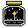
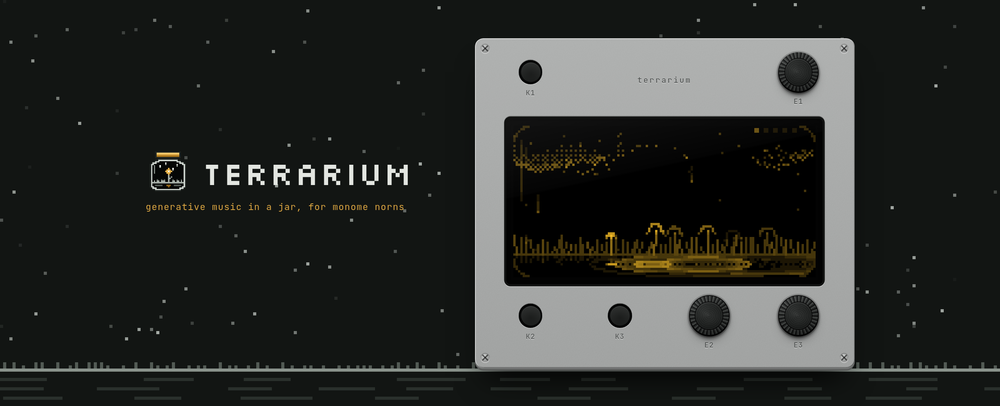
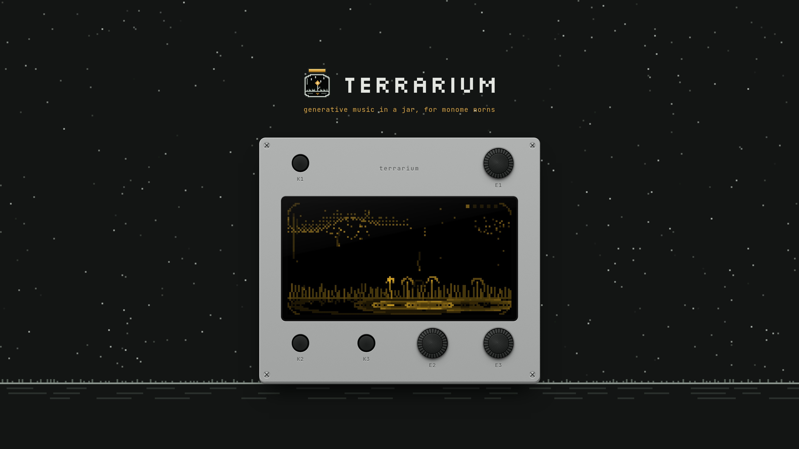
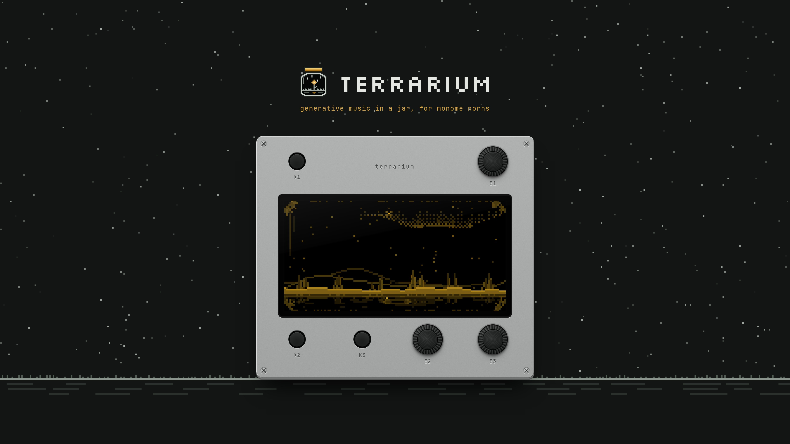
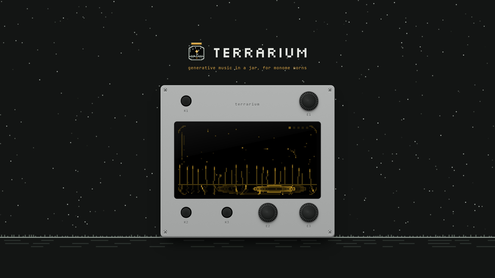

#  terrarium



🌱 A small world of modular instruments for [monome norns](https://monome.org/docs/norns/).

**[Read the manual](doc/MANUAL.md)** for how to play it (also as a [PDF](doc/terrarium-manual.pdf)),
or **[try it in your browser](https://carlosedp.github.io/terrarium/)**, phones included: the real
script, playing the real Mutable Instruments code. It also comes as a **VST3 / AU plugin** for your
DAW, on its tempo and automation: see [the plugin's manual](doc/PLUGIN-MANUAL.md) (and
[plugin/](plugin/README.md) for building it).

The patch is a landscape. Five parts each draw one piece of the scene and play one part of
the sound. Swap a module and that piece of the scene changes; turn a macro and the scene moves
with the sound. The screen shows no numbers.

| Part        | In the scene                                            | Modules                                                                                           |
| ----------- | ------------------------------------------------------- | ------------------------------------------------------------------------------------------------- |
| **weather** | when notes happen and which ones                        | rain (clocked to the norns clock), lightning (random), snow (drifting, and it settles)            |
| **soil**    | what grows from the ground: what plays                  | meadow (Plaits), crystals (Plaits 6-op FM), reeds (Rings), visitors (MIDI out, the audio in back) |
| **water**   | the pond and the fog: what shapes it                    | pond (Rings), fog (Ripples)                                                                       |
| **air**     | the sky: where it rings out                             | clouds (Clouds), fireflies (Beads), mountains (MiVerb)                                            |
| **hum**     | always there, under it all, on the key's root and fifth | aurora (Plaits), roots (Elements), none                                                           |

The whole scene sits behind the terrarium's glass. Rain beads up on it, and freezing the air
frosts it over.

Every note is a place: where it lands across the screen sets its pitch in the current key
and scale. The weather keeps a Turing Machine-style phrase, and each note leaves a mark on the
ground. **Change** sets how often notes are replaced, dropped to a rest or added back.
**Seasons** (slow by default) let the key drift between close neighbors and find its way home,
at dawn and dusk when the day is on, a note at a time.

> **Version 1.0.0.** The plugin and the browser version play the whole engine; on a norns it's
> still untested on hardware: the Lua side runs headless against a mocked norns (see
> [Development](#development)), and the SuperCollider engine still needs a real norns.

## Requirements

- norns (or norns shield / fates)
- [mi-UGens](https://github.com/carlosedp/norns-mi-UGens) built for norns. If they're missing,
  terrarium shows an installer instead of the scene: **K3** downloads and installs the latest
  build, **K2** installs a `mi-UGens-norns*.tar.gz` you copied into `dust/`. Restart norns after.
  Fireflies needs a build that includes MiBeads; without it, that module is hidden.

## Install

From the maiden REPL:

```
;install https://github.com/carlosedp/terrarium
```

## Controls

| Control      | Does                                                                                                                                  |
| ------------ | ------------------------------------------------------------------------------------------------------------------------------------- |
| E1           | choose a part (the others dim for a moment)                                                                                           |
| E2, E3       | that part's two macros (their names show for a moment while you turn)                                                                 |
| K2           | swap the part's module                                                                                                                |
| hold K2 + E2 | pick the module's variant: Plaits engine (meadow), DX bank (crystals), Rings model (reeds, pond), MIDI device (visitors), Clouds mode |
| K3           | gesture: new phrase (weather), strike (soil, water), freeze (air), hush / rise (hum)                                                  |
| hold K1      | peek at all parts; while held, E2 picks a setting and E3 changes it                                                                   |
| hold K1 + K3 | a new terrarium: random modules, varieties, knobs and settings, all but the day (also PARAMS > randomize the jar)                     |

**Climate** (a setting, off by default) lets a chaotic attractor slowly move the macros: fronts
(Lorenz), gusts (Rössler), tides (Thomas) or squalls (Chua). It moves them, the way CV moves a module's knobs: the macro you set is the center and
the climate pushes it around it. Each macro has a cv amount in PARAMS; the peek view shows
where each macro is right now and the attractor's path.

**Day** (a setting, off by default) adds the longest arc: a day and night of 20 minutes, an hour,
or following the norns' clock. Night slows the weather, darkens the soil, opens up the air and
brings the hum forward; the sky shows a sun by day and a moon and stars by night.

**Erosion** (a setting: off, faint, worn, deep, ancient; faint by default) gives the whole sound
the wear of an old recording: wow, flutter, crackle, hiss, a rolled-off top, a little warmth. It
glues the notes, the hum and the sky together; dust settles on the glass as it wears.

**Snow** (a weather module) falls slower and looser than rain and settles on the ground. The
snow cover muffles the soil, more the longer it snows; with the day on, the sun thaws it (the
meltwater drips a few soft notes) and the night lets it build up again.

**Breath** (a setting, gentle by default) adds silence: now and then the weather calms for a phrase
or three, notes rest (the phrase keeps them) and their marks dim, then it breathes in again.

**Presets:** norns saves them for you: in the norns menu, PARAMS > PSET > save / load. A preset
holds everything, including modules, variants, settings, levels, and whether the air is frozen
or the hum hushed.

A quick tap of K1 still opens the norns menu. Settings (key, scale, range, length, seasons,
climate, drift, day, breath, erosion),
every macro, and each module's fixed options (Plaits engine, DX bank, Rings model, Clouds
mode) are also in PARAMS, so they save with PSETs and can be MIDI-mapped.

## How it's built

```
terrarium.lua            script: parts, params, controls, drawing, the brain clock
lib/Engine_Terrarium.sc  engine: 2 Plaits voices -> color slot -> air slot -> out
lib/brain.lua            phrase, pitch mapping, seasons
lib/canvas.lua           128x64 framebuffer, blitted to the screen as merged runs
lib/glass.lua            the glass over the scene: rim, condensation, frost
lib/climate.lua          chaotic attractors that modulate the macros
lib/scene/*.lua          one file per module: its drawing, macros and sound mapping
lib/installer.lua        mi-UGens check and installer
doc/SOUND.md             macro -> mi-UGen parameter map (the tuning reference)
lib/Engine_Terrarium.js  the engine for norns-web: the same graphs, in Web Audio (norns ignores it)
lib/Engine_Terrarium/    the mi-UGens it plays, built as WebAssembly (`make mi-wasm`)
tools/norns-web/         runs the script's real Lua in a browser
test/                    mocked norns runtime and a smoke test
```

The Lua side owns every macro-to-parameter mapping (each module's `sound()` function, written
from [doc/SOUND.md](doc/SOUND.md)); the engine only exposes raw parameters per slot. Tuning the
sound means editing those functions.

On screen the parts are weather, soil, water, air and hum; in the code (param ids, `tune()`,
module files) they keep their working names: brain, voice, color, air and drone.

A module is one file under `lib/scene/` with `macros`, `draw`, `update`, and either
`wait`/`spawn`/`wind` (brain; `flash` optional) or `sound`/`on_note` (voice, color, air). Add it to `LAYERS` in `terrarium.lua`; a new
color or air module also needs a `terrarium_<id>` SynthDef in the engine.

## Development

`make` lists the common tasks: `make web` (the script in a browser), `make test`, `make deploy`
(copy to a norns over ssh; `NORNS=we@<ip>` if `norns.local` doesn't resolve).

Run the smoke test on a computer (Lua 5.3+):

```
lua test/smoke.lua
```

It loads the script against `test/mock_norns.lua`, plays every module, gesture and setting,
exercises the installer path, and prints screen calls per frame. It checks the Lua logic only:
no sound, no real screen.

`lua test/soak.lua [hours]` (`make soak`) runs the jar for hours of jar time (8 by default, about
1.5 minutes each) with climate, a day, seasons and breath on and a new terrarium every 20
minutes, and fails on what only shows up over hours: growing memory or lists, values out of range
or NaN, silence, a hum stuck hushed.

To see and play the real script in a browser, run [norns-web](tools/norns-web/README.md):

```
node tools/norns-web/serve.mjs     # then open http://localhost:8800/
```

It runs this Lua as is (screen, controls, clocks, PARAMS). The engine is `lib/Engine_Terrarium.js`:
each SynthDef rebuilt in Web Audio around the same mi-UGens, compiled to WebAssembly by
[norns-mi-UGens](https://github.com/carlosedp/norns-mi-UGens) (`./build.sh --wasm`) and kept in
`lib/Engine_Terrarium/` (`make mi-wasm` rebuilds them). Every push to main publishes it to
<https://carlosedp.github.io/terrarium/> (`.github/workflows/pages.yml`).

## Tuning

Each module's macro → parameter mapping is a table that `tune()` changes live from the maiden
REPL, printing the result to paste back; PARAMS > levels balances the slots. See
[doc/SOUND.md](doc/SOUND.md#tuning-on-the-norns) for the syntax and a first-night checklist.

## To do on hardware

- [ ] engine loads and every slot sounds; fix anything SuperCollider complains about
- [ ] CPU with the heaviest combination (2 Plaits + Rings + Beads); pick voice count from it
- [ ] screen frame time (the smoke test averages about 730 screen calls per frame and peaks around 1,550 with fog or a lightning flash; the pond's reflection is the main extra cost)
- [ ] tune ranges and curves in each module's `sound()` by ear (doc/SOUND.md lists open questions)
- [ ] visitors with a real synth: MIDI out, its audio back into the input (and the monitor level turned down)
- [ ] grid: phrase editing, key/scale picker

## Wallpapers

The device under the night sky, for a desktop (3840 × 2160) or a phone (1179 × 2556), in the
aluminium case or the black one. `make art` renders them again from the running script.

| Scene                                                                                                                                                                    | Desktop                                                                                                             | Phone                                                                                                           |
| ------------------------------------------------------------------------------------------------------------------------------------------------------------------------ | ------------------------------------------------------------------------------------------------------------------- | --------------------------------------------------------------------------------------------------------------- |
| <br>Rain on a meadow and a pond, clouds, an aurora | [aluminium](doc/art/wallpapers/meadow-desktop-alu.jpg) · [black](doc/art/wallpapers/meadow-desktop-black.jpg)       | [aluminium](doc/art/wallpapers/meadow-phone-alu.jpg) · [black](doc/art/wallpapers/meadow-phone-black.jpg)       |
| <br>Snow settling on crystals, mountains behind         | [aluminium](doc/art/wallpapers/snow-desktop-alu.jpg) · [black](doc/art/wallpapers/snow-desktop-black.jpg)           | [aluminium](doc/art/wallpapers/snow-phone-alu.jpg) · [black](doc/art/wallpapers/snow-phone-black.jpg)           |
| <br>Reeds over a pond, fireflies in the dark          | [aluminium](doc/art/wallpapers/fireflies-desktop-alu.jpg) · [black](doc/art/wallpapers/fireflies-desktop-black.jpg) | [aluminium](doc/art/wallpapers/fireflies-phone-alu.jpg) · [black](doc/art/wallpapers/fireflies-phone-black.jpg) |

## License and copyright

terrarium is made by [Voltage Foundry Modular](https://vfmod.com). © 2026 Voltage Foundry Modular.

- **The code** is free software under the GNU GPL v3.0 (see [LICENSE](LICENSE)): you can use,
  study, share and change it under its terms.
- **The terrarium name, the manual and its images** are © 2026 Voltage Foundry Modular, all rights
  reserved.
- **Built on others' work:** the sound is Émilie Gillet's
  [Mutable Instruments code](https://github.com/pichenettes/eurorack), via Volker Böhm's
  [mi-UGens](https://github.com/v7b1/mi-UGens) (GPL-3.0), installed separately on the norns. The
  browser version carries WebAssembly builds of seven of them in `lib/Engine_Terrarium/`, built
  from [norns-mi-UGens](https://github.com/carlosedp/norns-mi-UGens) (`BUILDINFO` there records
  the source).
  [wasmoon](https://github.com/ceifa/wasmoon) (MIT) is vendored in `tools/norns-web`. The plugin's
  downloads carry [THIRD-PARTY-NOTICES.txt](THIRD-PARTY-NOTICES.txt), with the licences of all it
  includes.
- Mutable Instruments, monome, norns and all other product names are trademarks of their
  respective owners, used only to identify what terrarium works with. No affiliation with or
  endorsement by them is implied.
