<!--
  How the pictures were made: the scene shots come from the real terrarium Lua, run headless and
  captured frame by frame (exact pixels). The five marked "retake on norns" show text, which was
  drawn by the browser emulator's stand-in font; replace them with real screenshots. On the norns,
  from the maiden REPL:  screen.export_png("/home/we/dust/data/terrarium/peek.png")
  Placeholders for photos are marked PHOTO.
-->

# terrarium

_generative music in a jar, for monome norns_

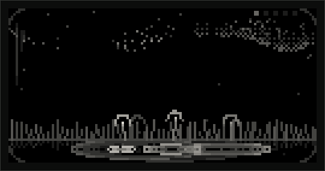

<!-- PHOTO: your norns on a table, running terrarium -->

terrarium is a small world in a jar that makes music. Weather falls on a landscape, and wherever
it lands, a note plays: rain on a meadow blooms flowers, lightning strikes crystals, ripples
spread across a pond, and the sound drifts up into the clouds. You don't patch anything. You
choose what lives in each part of the jar, and you shape it with two knobs.

It's built for long, slow listening. Leave it running and it keeps changing: the phrase drifts,
the key turns with the seasons, the weather comes and goes, and day turns into night.

It's a living world of sound, grown from the modules of Mutable Instruments. Plaits blooms in
the meadow, Rings rings through the pond and the reeds, Clouds and Beads drift through the sky,
and Elements breathes under the ground. Émilie Gillet's instruments, alive inside your norns.

---

## Contents

- [What you need](#what-you-need)
- [The first minutes](#the-first-minutes)
- [Playing it](#playing-it)
- [A field guide to the jar](#a-field-guide-to-the-jar)
- [Letting it grow: the slow settings](#letting-it-grow-the-slow-settings)
- [Saving what you like](#saving-what-you-like)
- [A few places to start](#a-few-places-to-start)
- [If something seems wrong](#if-something-seems-wrong)
- [Appendix: how it works](#appendix-how-it-works)
- [Credits](#credits)

---

## What you need

- A **norns** (any kind: the original, shield, or fates).
- The **mi-UGens**, the Mutable Instruments sound modules for norns. You don't need to find
  them: the first time you open terrarium without them, it offers to install them for you.
- Optional: **nb voices** (like Emplaitress or Doubledecker, installed as norns mods) or a MIDI
  synth, if you'd like visitors in your jar. More on that in [visitors](#visitors).

To install terrarium, type this in the maiden REPL:

```
;install https://github.com/carlosedp/terrarium
```

### The first time you open it

If the Mutable Instruments modules aren't on your norns yet, terrarium shows a short message
instead of the landscape. Press **K3** to download and install them (it needs Wi-Fi), then go to
**SYSTEM > RESTART** in the norns menu and open terrarium again. You only do this once. terrarium installs its own norns build of the mi-UGens, which includes
Beads.

<!-- PHOTO or screenshot: the installer screen ("terrarium needs mi-UGens") -->

---

## The first minutes

Open terrarium and just listen for a while.

Rain falls on the meadow. Each drop lands somewhere along the ground, and **that place is the
note**: further left is lower, further right is higher. Where it lands, a flower blooms and the
pond ripples. The sound rises into the clouds.

The drops aren't random. The weather keeps a short **phrase** of notes, and plays it over and
over, changing a note now and then. You can see the phrase as small puddles along the ground,
one for each note. When a note changes, its puddle glows for a moment.

Above it all, a quiet **drone** holds everything together, shown as an aurora across the top of
the sky.

---

## Playing it

Terrarium has **five parts**, from the weather down to the drone. You pick a part, then shape it.

|                       |                                                                                                         |
| --------------------- | ------------------------------------------------------------------------------------------------------- |
| **E1**                | choose a part: brain (the weather), voice (the ground), color (light and water), air (the sky) or drone |
| **E2, E3**            | shape that part (each part has two knobs)                                                               |
| **K2**                | swap what lives in that part (meadow → crystals → reeds…)                                               |
| **hold K2 + turn E2** | choose its variety (which flowers, which kind of resonance, which NB voice…)                            |
| **K3**                | that part's gesture (see below)                                                                         |
| **hold K1**           | peek at everything, and change the settings                                                             |
| **hold K1 + K3**      | a new terrarium: everything chosen at random                                                            |

### Choosing a part

Turn **E1**. The part you choose stays bright while the rest of the jar dims for a moment, and
its name appears at the top, along with what its two knobs do.

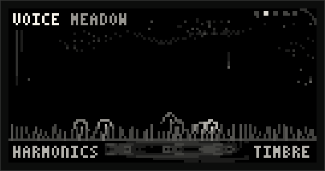

<!-- retake on norns -->

### Shaping it

**E2** and **E3** are the part's two knobs. Their names show at the bottom while you turn: E2 on
the left, E3 on the right, where the knobs are on your norns. The bar shows where it is.

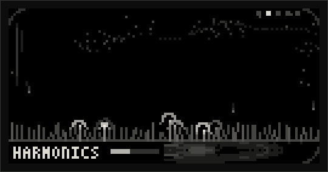

<!-- retake on norns -->

There are no numbers. **The picture is the readout**: turn harmonics and the grass grows taller;
turn timbre and the flowers open wider. Every knob changes something you can see.

### Swapping and varieties

**K2** swaps what lives in the part: the meadow becomes crystals, then reeds, then visitors.

**Hold K2 and turn E2** to choose a variety without swapping: a different kind of flower on the
meadow, a different resonance in the pond. Its name appears as you turn.

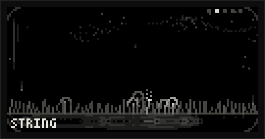

<!-- retake on norns -->

### Gestures (K3)

| Part         | K3                                                                  |
| ------------ | ------------------------------------------------------------------- |
| brain        | a new phrase: the weather forgets its notes and starts another      |
| voice, color | strike: play a note right now                                       |
| air          | freeze: hold the sky still (and the jar frosts over); again to thaw |
| drone        | hush: the drone fades out; again to let it rise                     |

### Peeking (hold K1)

**Hold K1** to see all five parts at once, with both knobs of each as bars. The bottom line is
the settings: while K1 is held, **E2** chooses a setting and **E3** changes it. Let go and you're
back in the landscape.

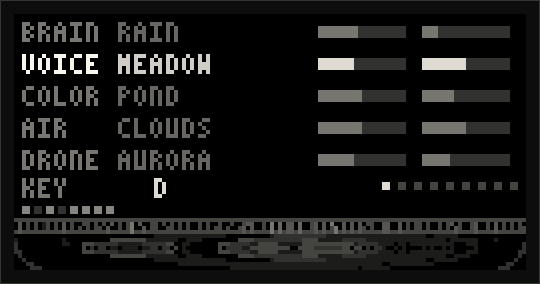

<!-- retake on norns -->

A quick _tap_ of K1 opens the norns menu, as usual. Terrarium only uses K1 while it's held.

### A new terrarium (hold K1 + K3)

Hold **K1** and press **K3**, and the jar fills with something new: every part gets a random
module, variety and knob settings, the settings change too (key, scale, range, length, seasons,
climate, drift and breath), and a light sweeps along the ground as the new key appears. Press
again until something catches your ear, then shape it from there. (It never picks visitors or an
empty drone, and leaves the day alone: that one is about your time, not the music. It's also in
**PARAMS > randomize the jar**.)

---

## A field guide to the jar

### brain: the weather

The weather decides **when** notes happen and **which** ones.

#### rain

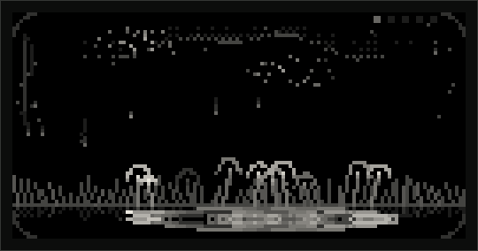

Rain falls in time with the norns clock, so it plays along with other scripts and gear.

- **E2 rate**: from a slow drip to a downpour.
- **E3 change**: how often the phrase changes a note. More change brings wind: the rain slants,
  the grass sways. All the way down, the phrase repeats forever.

Heavy rain beads up on the glass of the jar, and now and then a drop runs down.

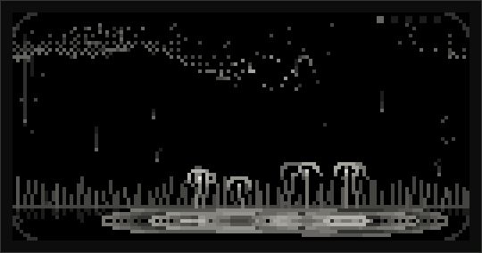

#### lightning

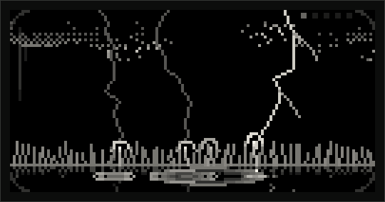

Lightning strikes at random moments, sometimes twice in a row, and lights up the whole landscape.
The same note always strikes with the same bolt.

- **E2 rate**: how often it strikes.
- **E3 change**: how often the phrase changes; more change, a wilder storm.

### voice: the ground

The voice is **what plays** the notes.

#### meadow

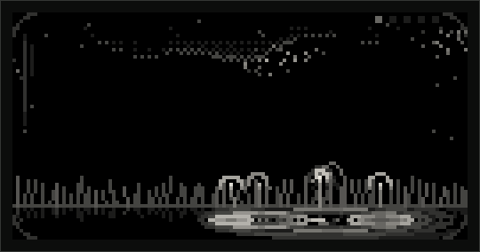

Every note blooms a flower where it lands.

- **E2 harmonics**: the grass grows taller; the tone gets richer.
- **E3 timbre**: the flowers open wider; the tone gets brighter.
- **Varieties (hold K2 + E2):** twelve different sounds, and each grows its own kind of flower:
  bells, seed spikes, petals, tulips, umbels, stars and dandelions.

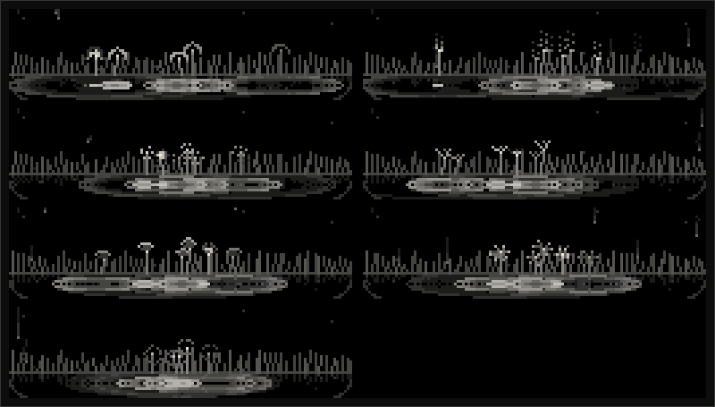

#### crystals

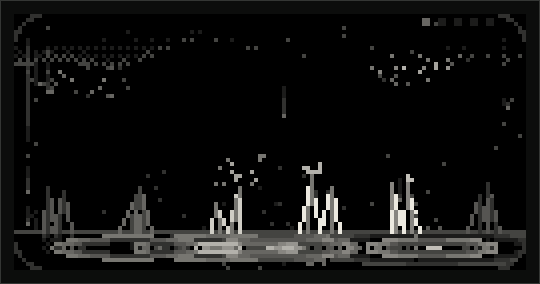

Glassy, bell-like tones. Each note makes the nearest crystal glint and throw sparks.

- **E2 ratio**: the crystals grow taller and sharper.
- **E3 index**: more sparks, a more metallic ring.
- **Varieties:** three banks of crystal sounds.

#### reeds

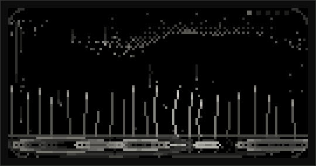

Each note plucks a reed by the water, and you can see it vibrate like a string.

- **E2 structure**: taller, bent reeds; stranger, more bell-like resonances.
- **E3 brightness**: the reed heads light up; a brighter tone.
- **Varieties:** six kinds of resonance. In _sympathetic strings_, the reeds next to the one you
  pluck start ringing too.

#### visitors

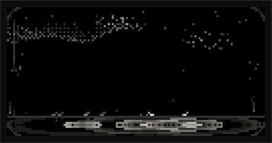

Visitors are voices from outside the jar: an nb voice (a norns mod like Emplaitress or
Doubledecker), a MIDI synth, or Just Friends. Each voice brings its own creatures (ants, beetles
or moths), which wander in from the edge. When a note plays, the nearest one hurries over and
glows for as long as the note lasts.

- **Choose the voice:** hold K2 and turn E2. With "none", nothing arrives and nothing plays.
- **E2 modulate**: whatever that voice chooses to do with it.
- **E3 length**: how long each note lasts.

Visitors bring their own sound: the pond, the fog and the sky don't change it.

### color: light and water

Color is **what shapes** the voice's sound.

#### pond

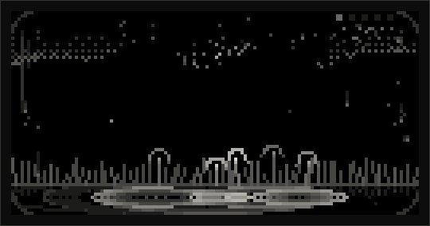

Every note sends ripples across the pond and makes it ring in tune. The water mirrors the
landscape above it, and the ripples bend the reflection.

- **E2 structure**: more rings, a richer resonance.
- **E3 damping**: how long the ripples last, and how long the pond rings.
- **Varieties:** six kinds of resonance.

#### fog

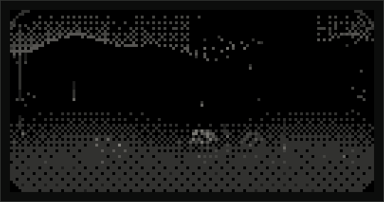

Fog closes in as the sound gets darker, and the whole jar dims with it.

- **E2 clarity**: lifts the fog and opens up the sound.
- **E3 shimmer**: makes the fog waver; the sound gets a resonant edge.

### air: the sky

The air is **where the sound rings out**.

#### clouds

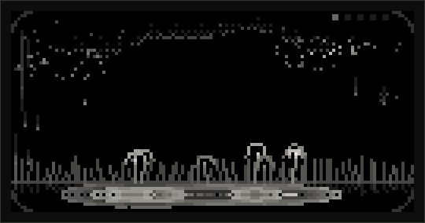

Clouds made of tiny grains of sound drift across the sky; they flicker when a note passes through.

- **E2 density**: more grains, thicker clouds.
- **E3 size**: bigger, wider clouds.
- **Varieties:** granular, pitch shifter, looping delay, spectral.
- **K3 freeze** holds the sound in the air, and the glass frosts over until you thaw it.

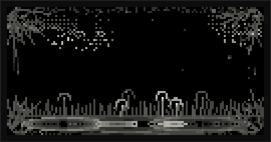

#### fireflies

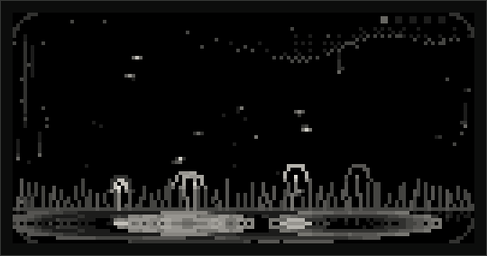

Each grain of sound is a firefly, like little beads in the air. The ones nearest a note light up.

- **E2 density**: more fireflies.
- **E3 glow**: longer trails, longer grains.
- **K3 freeze**, as for clouds.

#### mountains

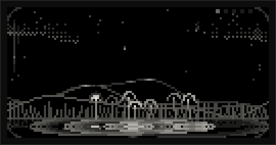

The bigger the room, the bigger the mountains. Each note echoes back off the far ridge.

- **E2 size**: taller, more distant ranges; a longer reverb.
- **E3 echo**: more of the sound goes into the mountains.

### drone: the bed under it all

A soft, sustained sound on the key's root and fifth. It holds the music together between notes,
follows the key, and glides when the key changes. **K3** hushes it and lets it rise again.

#### aurora

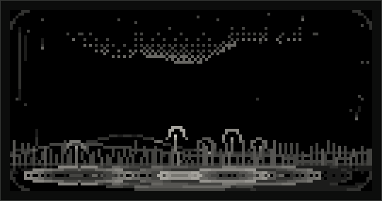

Curtains of light across the top of the sky. They flare when a season turns.

- **E2 glow**: a warmer or brighter drone, and brighter curtains.
- **E3 motion**: how much the drone and the curtains drift.
- **Varieties:** seven drone sounds.

#### roots

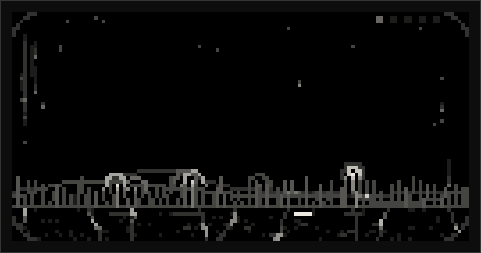

A bowed and blown drone, drawn as roots under the ground with light flowing down them.

- **E2 breath**: from bowing to blowing.
- **E3 depth**: a bigger, more spacious sound; the roots reach further.
- **Varieties:** three kinds of resonance.

#### none

No drone at all, for when you'd rather have silence between the notes.

---

## Letting it grow: the slow settings

Hold **K1**; **E2** chooses a setting, **E3** changes it. They're all in **PARAMS > settings**
too.

| Setting            | What it does                                                                |
| ------------------ | --------------------------------------------------------------------------- |
| **key**, **scale** | the notes the landscape plays: major, minor, dorian, pentatonic, hirajoshi… |
| **range**          | how many octaves the land spans, from left to right (1 to 3)                |
| **length**         | how many notes are in the phrase (4 to 16)                                  |
| **seasons**        | lets the key change by itself, slowly                                       |
| **climate**        | slow, ever-changing movement of all the knobs                               |
| **drift**          | how fast the climate moves                                                  |
| **day**            | a day and night                                                             |
| **breath**         | moments of calm                                                             |

### seasons

Every few phrases, the key moves to a close neighbor, changing only one or two notes, so the
music shifts gently instead of jumping. The key you set is home: the seasons wander away and
keep finding their way back. A light sweeps along the ground when a season turns, and the
aurora flares.

_slow_, _steady_ and _quick_ turn the season every 8, 4 or 2 phrases.

### climate and drift

The climate moves every knob a little, all the time, like weather passing through. Your
settings stay the center; the climate pushes them around it, never too far. All five parts move
together, because they follow the same climate.

There are four climates, each with its own way of moving:

- **fronts**: settles into one mood, then switches to another at unexpected moments
- **gusts**: rolls along smoothly, then suddenly gusts
- **tides**: slow and rolling, like a tide coming in and out
- **squalls**: flips abruptly between two moods

**drift** sets how fast: _slow_ (about 40 seconds per cycle), _medium_ or _fast_.

When the climate is on, the peek view shows a small tick on each bar, where the climate has
pushed that knob right now. On the climate setting, you can see the climate's path.

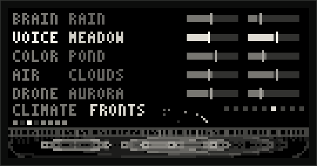

<!-- retake on norns -->

### day

A day and a night pass in the jar: in **20 min**, **1 hour**, or following your norns' **clock**,
so that night in the jar is night outside. By night the weather slows, the sound darkens, the
sky opens up and the drone comes forward. By day, the reverse.

|                                                                   |                                                        |
| ----------------------------------------------------------------- | ------------------------------------------------------ |
| 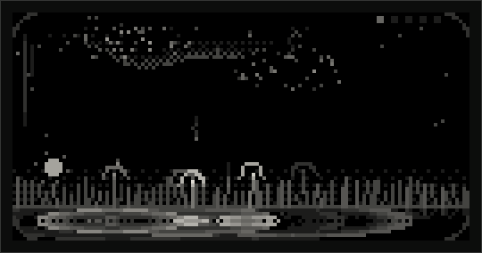             | 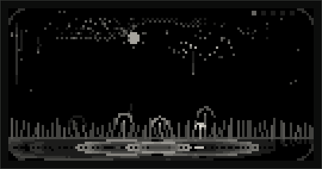     |
| 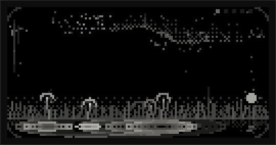 | 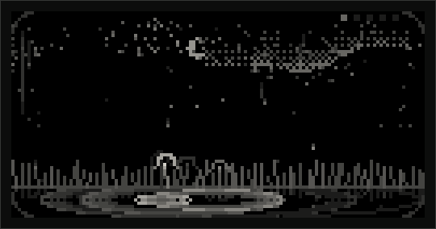 |

### breath

Music needs space. With breath on, the weather sometimes calms for a phrase or three: notes
rest, their puddles dim, and then it breathes in again. The phrase isn't lost; the notes come
back when the calm passes. _gentle_ calms now and then; _deep_ calms more often, and deeper.

---

## Saving what you like

norns keeps presets for you. In the norns menu (a quick tap of K1), go to **PARAMS**, and
**PSET** is at the top: _save_, _load_, _delete_. A preset remembers everything: which modules
live in each part, their varieties, every knob, the settings, and even whether the air is frozen
or the drone hushed.

---

## A few places to start

These are starting points. Set one up, then let it grow, or hold **K1 + K3** until something
surprises you.

**Rain on the meadow** (how terrarium opens): rain, meadow, pond, clouds, aurora. Just listen.
Then try _seasons: slow_.

**Night pond**: lightning with a low rate, reeds, pond with low damping (long ringing), mountains
with a big size, roots. Settings: _day: clock_, _breath: deep_. Best late at night.

**Glass garden**: rain with a little change, crystals, fog with some shimmer, fireflies with long
glow, aurora. _climate: tides_, _drift: slow_.

**Still air**: anything you like, then freeze the clouds (K3 on air) and let the frost come in.
Swap the voice while the sky stays frozen.

**A visitor**: install an nb voice, choose visitors on the voice, pick the voice (hold K2 + E2),
and watch the creatures come in. Try it with the drone hushed.

<!-- These will get specific values once the sound has been tuned on the norns. -->

---

## If something seems wrong

**It shows "terrarium needs mi-UGens".** The sound modules aren't installed yet. Press K3 (with
Wi-Fi), then **SYSTEM > RESTART**. If you copied a `mi-UGens-norns*.tar.gz` into `dust/` yourself,
press K2 instead.

**It says "mi-UGens without Beads" (or Elements).** Your norns has an older build of the
mi-UGens. Press K3 to update to terrarium's (with Wi-Fi), then **SYSTEM > RESTART**. Or press K2
to carry on without them: everything works except fireflies (Beads) or roots (Elements).

**Visitors: nothing arrives.** Hold K2 and turn E2 on the visitors to pick a voice. If the only
choice is "none", install an nb voice mod (and enable it in **SYSTEM > MODS**), or connect a MIDI
synth before opening terrarium.

**Visitors sound dry.** That's on purpose: visitors bring their own sound from outside the jar,
so the pond, the fog and the sky don't change it.

**Crackles or dropouts.** Some combinations are heavier than others: reeds with the pond and
roots is the heaviest. Swap one of them, or choose _none_ for the drone.

**I tapped K1 and the norns menu opened.** Terrarium only uses K1 while it's _held_. A tap is
the norns menu, as usual.

---

## Appendix: how it works

### The idea

terrarium is a semi-modular synthesizer drawn as a landscape. Free patching on a 128×64 screen
with three knobs would be miserable, so the routing is fixed, like a semi-modular: you choose what
sits in each slot, and two macros per slot move several parameters at once along hand-picked
ranges. The scene is the only readout.

### The signal path

```
brain (rain | lightning)          when and which notes; no sound of its own
   │ notes (pitch = where they land)
   ▼
voice (meadow | crystals | reeds)    visitors play outside, through nb
   ▼
color (pond | fog)
   ▼
air (clouds | fireflies | mountains)  ◄── drone (aurora | roots)
   ▼
output
```

### What's inside

| Part  | Module    | Mutable Instruments module  | E2        | E3         | hold K2 + E2     |
| ----- | --------- | --------------------------- | --------- | ---------- | ---------------- |
| brain | rain      | (norns clock)               | rate      | change     | —                |
| brain | lightning | (random timing)             | rate      | change     | —                |
| voice | meadow    | Plaits (12 melodic engines) | harmonics | timbre     | Plaits engine    |
| voice | crystals  | Plaits (6-op FM banks)      | ratio     | index      | FM bank          |
| voice | reeds     | Rings (internal exciter)    | structure | brightness | resonator type   |
| voice | visitors  | any nb voice                | modulate  | length     | nb voice         |
| color | pond      | Rings                       | structure | damping    | resonator type   |
| color | fog       | Ripples                     | clarity   | shimmer    | —                |
| air   | clouds    | Clouds                      | density   | size       | mode             |
| air   | fireflies | Beads                       | density   | glow       | —                |
| air   | mountains | MiVerb (Clouds' reverb)     | size      | echo       | —                |
| drone | aurora    | Plaits ×2 (root and fifth)  | glow      | motion     | Plaits engine    |
| drone | roots     | Elements                    | breath    | depth      | resonator type   |

The phrase works like a Turing Machine: a loop of notes and rests where **change** sets the
chance that a step mutates as it plays. **Seasons** move between keys that share all but one or
two notes, and each place on the land is a fixed semitone, so shared notes stay where they are.

The four climates are chaotic attractors, the same kind of slowly unfolding, never-repeating
motion found in weather and electronics: **fronts** is the Lorenz attractor (Edward Lorenz found
it while modeling weather), **gusts** is Rössler's, **tides** is Thomas', and **squalls** is
Chua's circuit. Their three outputs are linked, so the parts move together.

### Tuning

Each module's knobs are a small table of ranges. In the maiden REPL, `tune()` changes one while
terrarium plays and prints the table, ready to paste back into the script:

```
tune("clouds")                          -- see clouds' table
tune("clouds", "rvb", 2, 0.1, 0.6)      -- clouds' E3 (size) also opens its reverb
```

**PARAMS > levels** sets the balance between the voice, color, air and drone. The full sound map
and tuning notes are in [SOUND.md](SOUND.md); the design decisions are in [DESIGN.md](DESIGN.md).

### In a browser

terrarium can run in a web browser for development: `make web` in the repository, then open
<http://localhost:8800/>. It's the same Lua code with rough sound stand-ins, not the Mutable
Instruments modules. In the browser, visitors come with one simple built-in voice ("web synth").
See [tools/norns-web](../tools/norns-web/README.md).

---

## Credits

terrarium is made by **[Voltage Foundry Modular](https://vfmod.com)**: Eurorack modules, mostly,
and adventures into anything else that makes sound.

Its sound is built on Émilie Gillet's Mutable Instruments modules, brought to SuperCollider by
Volker Böhm's mi-UGens, and runs on monome's norns. Visitors arrive through sixolet's nb.
Thank you all.

© 2026 Voltage Foundry Modular. The terrarium name, this manual and its images are all rights
reserved. The code is free software under the GNU GPL v3.0. Mutable Instruments, monome, norns
and all other product names are trademarks of their respective owners, used only to identify
what terrarium works with; no affiliation or endorsement is implied.
