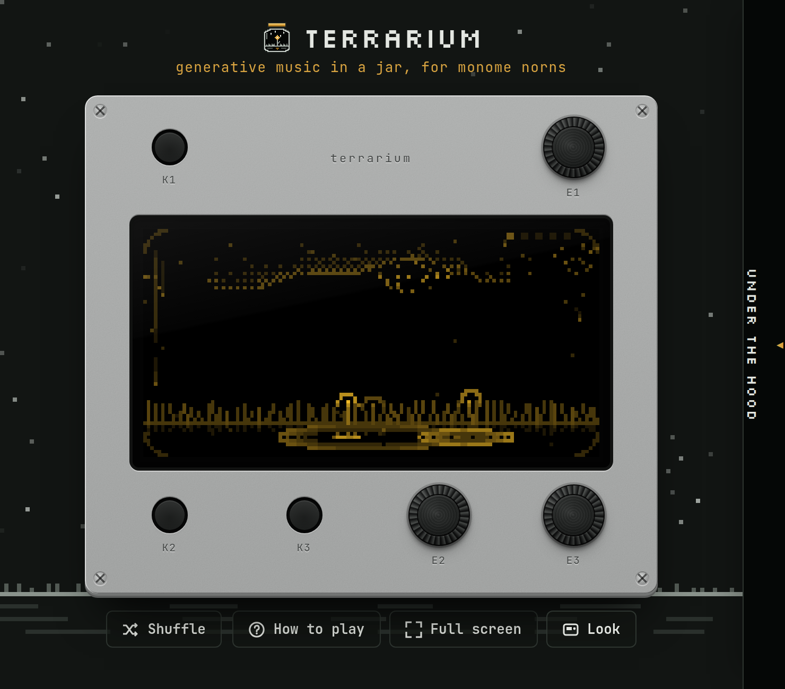
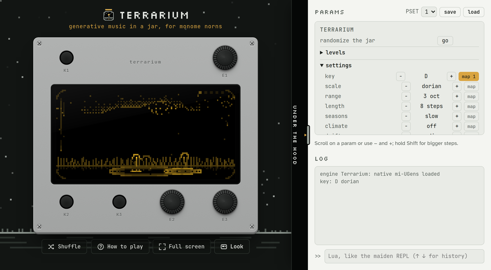

# terrarium, the plugin

_generative music in a jar, in your DAW_ · version 1.0.0

terrarium is a small world in a jar that makes music: weather falls on a landscape, and wherever
it lands, a note plays. It was made for monome norns, and this is the same terrarium as a plugin
(VST3 and AU) and a standalone app: the same script, the same Mutable Instruments sound, now on
your DAW's tempo, its automation lanes and its mixer.

This manual covers what's different in a DAW: installing it, the window, the tempo, automation,
saving, and routing the visitors. What lives in the jar, and how each part sounds and behaves,
is in [the terrarium manual](MANUAL.md): its [field guide to the jar](MANUAL.md#a-field-guide-to-the-jar)
and [the slow settings](MANUAL.md#letting-it-grow-the-slow-settings) apply here as they are.

---

## Contents

- [Installing it](#installing-it)
- [The window](#the-window)
- [Playing it](#playing-it)
- [In time with your DAW](#in-time-with-your-daw)
- [Automation](#automation)
- [Saving](#saving)
- [Visitors: a synth beside the jar](#visitors-a-synth-beside-the-jar)
- [If something seems wrong](#if-something-seems-wrong)

---

## Installing it

Each download holds the plugin and a standalone app.

**Windows** (64-bit, Windows 10 or 11):

- Copy **terrarium.vst3** (the whole folder) into `C:\Program Files\Common Files\VST3\`.
- Rescan your plugins, and find **terrarium** (Voltage Foundry Modular) among the instruments.
- The standalone: run **terrarium.exe**, with the **terrarium-resources** folder beside it.

**macOS** (Intel or Apple Silicon):

- **terrarium.component** (AU, for Logic) goes in `~/Library/Audio/Plug-Ins/Components/`, and
  **terrarium.vst3** in `~/Library/Audio/Plug-Ins/VST3/`.
- Restart your DAW. The standalone is **terrarium.app**.

It works in any DAW that hosts VST3 or AU instruments: Ableton Live, Reason (12 and later),
Logic Pro, Bitwig, Reaper, Cubase. It plays on a stereo instrument track.

---

## The window

The window is a norns shield under a night sky: its screen, three keys (K1, K2, K3) and three
knobs (E1, E2, E3), exactly as on a norns.

- **Knobs:** drag one up and down, or scroll on it.
- **Keys:** click and hold, as you'd press and hold a real one.
- **Keyboard:** A, S and D are the keys (hold them like real ones); Y and H turn E1 up and
  down, U and J turn E2, I and K turn E3. Hold S and tap U for "hold K2 + turn E2".
  Press **?** for all of it.
- **Shuffle:** a whole new terrarium at random (the same as holding K1 + K3).
- **How to play:** the controls, one page.
- **Full screen:** just the device, as big as it gets. Esc to leave.
- **Look:** a norns or a shield, a yellow or white screen, and
  [stop with the DAW's transport](#when-the-transport-stops).

Make the window smaller and the device shrinks with it; the window never scrolls.

### Under the hood

The tab along the right edge opens **Under the hood**: every parameter of terrarium (as in the
norns' PARAMS menu), presets, the log, and a Lua console. The window grows wider to make room, so
the jar stays in view. Drag the handle on the drawer's left edge to make it wider or narrower.

- **PARAMS:** every setting, macro and module. Scroll on one, or use − and +; hold Shift for
  bigger steps. **map** binds a parameter to your DAW's automation (see [Automation](#automation)).
- **PSET:** save and load presets inside the plugin (eight slots, kept with the project).
- **Log:** what terrarium says, and any errors. A red badge on the tab counts errors while it's
  closed.
- **Lua:** the maiden REPL, for the curious: `params:get("t_root")`, `params:set("t_scale", 3)`.

---

## Playing it

Exactly as on a norns: **E1** picks a part of the jar (weather, soil, water, air, hum), **E2** and
**E3** shape it, **K2** swaps what lives there, **K3** is the part's gesture, **hold K2 + E2**
picks a variety, **hold K1** peeks at the whole jar, and **hold K1 + K3** grows a new terrarium.
The full story is in [Playing it](MANUAL.md#playing-it) in the terrarium manual.

The only thing a plugin can't do is K1's quick tap: there's no norns menu here. The norns
menu's PARAMS are in the drawer instead.

---

## In time with your DAW

terrarium's clock is your DAW's: the rain falls on your session's tempo and lands on its beat.
Change the tempo and the weather follows; start, loop or jump around the timeline and it falls
back into step. Notes land within a fraction of a millisecond of the grid.

Snow is the exception, as on a norns: it drifts down slowly, and each flake plays when it lands,
off the grid. Lightning strikes when it likes.

The sound is the same at any sample rate: terrarium runs at 48 kHz inside, as a norns does, and
converts to your session's rate (44.1, 48, 88.2, 96 kHz...).

### When the transport stops

By default the jar keeps going when you stop the transport, as a norns would: the rain falls on
its own clock. If you'd rather it follow the transport, turn on **stop with the DAW's transport**
(in Look, or as a parameter in your DAW): then the weather stops when the transport stops (what's
ringing rings out, the hum goes on), and comes back on the beat when you press play.

---

## Automation

Your DAW sees a short list of parameters:

- **weather 1** … **hum 2**: the two knobs of whatever lives in each part, named after it:
  "weather 1: rain rate", "soil 2: meadow timbre". Swap the module and the same lane drives the new
  one's knob: an automation lane on "soil 1" moves the meadow's harmonics, then the crystals'
  whatever-they-have, without redrawing anything.
- **map 1** … **map 8**: for anything else. In the drawer, click **map** beside any parameter
  (a module, the key, the scale, the erosion, a cv amount) and it takes the next free slot,
  which takes its name: "map 1: key". Click it again to free the slot.
- **stop with the DAW's transport**.

Lanes and the jar follow each other: draw a lane and the knob moves; turn the knob (in the window,
or on the screen with E2 and E3) and, with your DAW recording automation, the lane follows.

---

## Saving

Everything is saved with your project: every parameter (the modules, their varieties, every
knob, the settings), the map bindings, the look of the window, and the presets in the drawer.
Open the project and the jar is as you left it, though never quite the same music: it's
generative, so it grows on from there.

---

## Visitors: a synth beside the jar

On a norns, the visitors send their notes over MIDI to a synth beside it, and the synth's sound
comes back into the norns' input, where the water and the sky shape it like any other soil. The
plugin does the same with your DAW: visitors send notes to a synth, and its sound comes back
through the plugin's **side chain**.

**1. Choose visitors** on the soil (K2), then **choose where the notes go** (hold K2 and turn
E2):

- **1: DAW (plugin MIDI out):** the plugin's own MIDI output, for a DAW that passes an
  instrument's MIDI on to another track.
- **2 and on:** your computer's MIDI outputs, which terrarium opens itself: a hardware synth, or a
  virtual MIDI port another track listens to (**loopMIDI** on Windows, the **IAC Driver** on
  macOS). This works in any DAW. The list is read when the plugin loads; connect a new device,
  then reload the plugin.
- **none:** no notes go out, but the side chain still plays: send anything in and let the
  weather open it.

The MIDI channel is in the drawer's PARAMS ("visitors midi channel").

**2. Send the synth's sound into terrarium's side chain**, called **Visitors**. Each note opens
it for a moment; **E2 (opening)** lets some through between notes, **E3 (length)** sets how long
each note lasts. Mute the synth's own track (or set its output to the side chain only), or you'll
hear it dry under the jar's version.

<!-- To confirm in each DAW: the DAW-port routes (Live's MIDI From a plugin track, Reason's
     MIDI out on the rack) and Live's instrument side chain. The virtual-port routes are sure. -->

### In Ableton Live

- **The notes:** make a MIDI track with the synth, and try setting its **MIDI From** to
  terrarium's track, with terrarium on **1: DAW**. If Live doesn't offer terrarium there, use a
  virtual port, which always works: create one with loopMIDI (Windows) or the IAC Driver (macOS,
  in Audio MIDI Setup), pick it in terrarium (hold K2 + E2), and set the synth track's **MIDI
  From** to that port, with its monitor on **In**.
- **The sound:** open terrarium's device, show its **Sidechain** section, and pick the synth's
  track as the source.

### In Reason

- **The notes:** the sure way is a virtual port (loopMIDI on Windows, the IAC Driver on macOS):
  pick it in terrarium (hold K2 + E2) and play the synth's track from it. Or try **1: DAW**, and
  route terrarium's MIDI out to the synth if your Reason offers it for the plugin.
- **The sound:** on the back of the rack, patch the synth's audio output into terrarium's
  **Sidechain** input.

### In Logic Pro

Logic doesn't pass an instrument's MIDI on, so use the IAC Driver:

- **The notes:** in **Audio MIDI Setup > MIDI Studio**, open the **IAC Driver** and tick **Device is
  online**. Reload terrarium, pick the IAC bus (hold K2 + E2), and make a software instrument track
  with the synth, record-enabled (or with its input monitoring on) so it plays what arrives on
  the IAC bus.
- **The sound:** in terrarium's plugin window, choose the synth's track in the **Side Chain** menu at
  the top.

### With a hardware synth

Pick its MIDI output in terrarium (hold K2 + E2), and bring its audio into your interface on an
audio track. Send that track into terrarium's side chain, and turn the audio track's own output
down.

---

## If something seems wrong

**The window is dark, with no device.** The window is a web page inside the plugin. On Windows it
needs Microsoft's WebView2, which Windows 10 and 11 normally have; if it's missing, install the
"WebView2 Runtime" from Microsoft. The jar keeps playing even without the window.

**"terrarium didn't start".** The plugin couldn't find the files it carries (the jar's script and
its sound modules). Install the whole **terrarium.vst3** folder (or **.component**) as it came, not
just a file from inside it. For the standalone, keep **terrarium-resources** beside the app.

**The visitors' synth doesn't play.** Check the port (hold K2 + E2) and the channel (in PARAMS).
If the port is a device another program has open, Windows won't share it: the log says "can't
open MIDI output". Close the other program, or use a virtual port.

**I hear the synth twice.** Its own track is still playing: mute it, or route it only to
terrarium's side chain.

**The rain doesn't follow my tempo.** It follows the transport while it plays. Stopped, it runs on
its own (or stops, with [stop with the DAW's transport](#when-the-transport-stops)).

**It's using a lot of CPU.** The heaviest jar (reeds, fireflies, roots and the tape) takes about a
tenth of one core. Clouds, fireflies and roots are the heavy ones; mountains and fog are light.

---

terrarium is made by Voltage Foundry Modular (vfmod.com). Its code is free software under the
GNU GPL v3.0; the terrarium name, this manual and its images are all rights reserved. The sound is
Émilie Gillet's Mutable Instruments code (MIT), through Volker Böhm's mi-UGens (GPL-3.0).
Mutable Instruments, monome, norns, Ableton, Live, Reason, Logic and VST are trademarks of their
owners, named only to say what terrarium works with; no affiliation or endorsement is implied.
